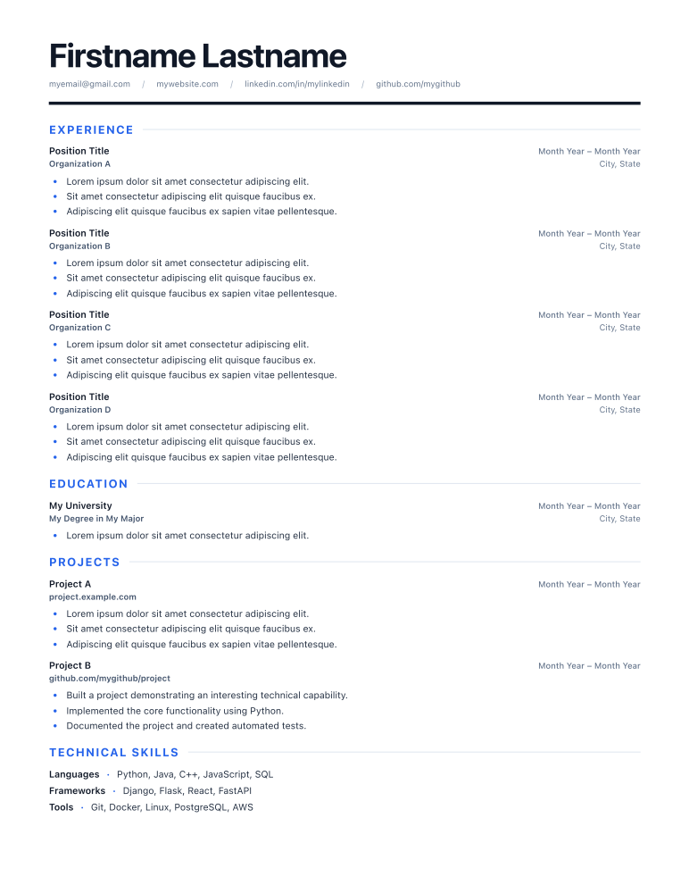
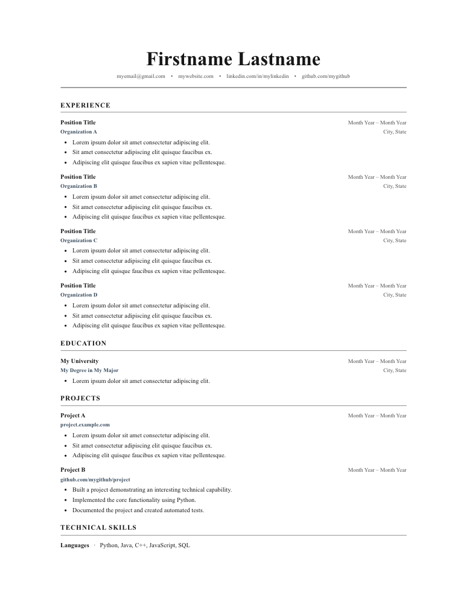
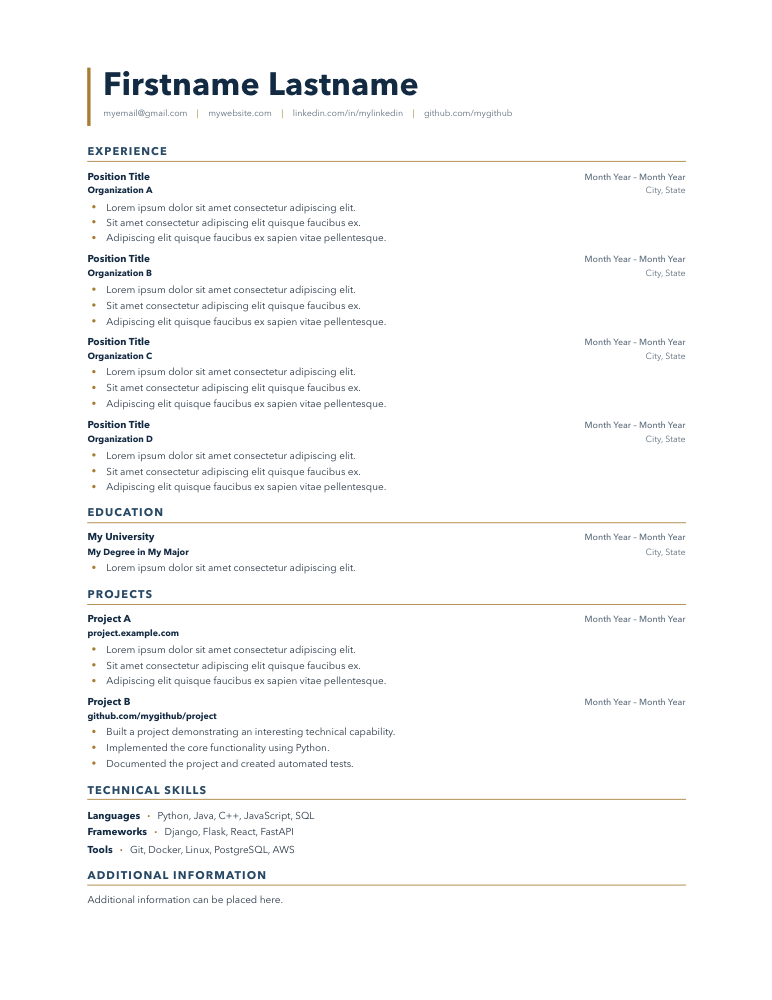
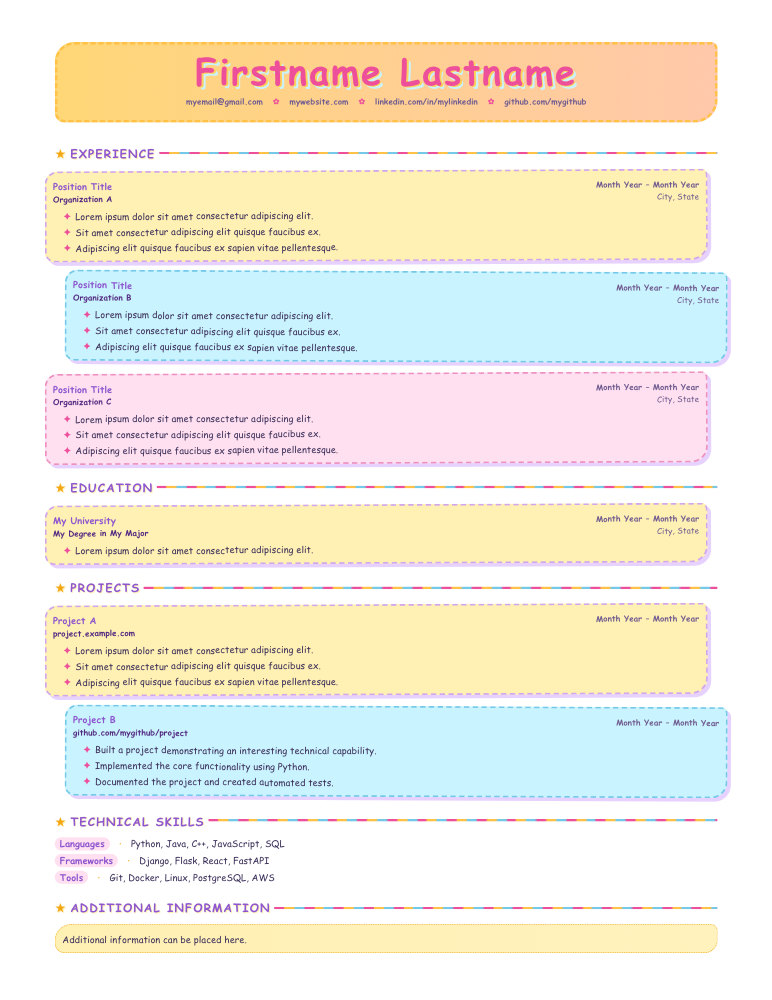

# FART: Freaking Awesome Resume Template

### Your resume, maintained as one local YAML file.

Keep your experience and contact details in a simple file on your computer. Generate a polished PDF or a standalone HTML resume whenever you need an update—without hand-editing HTML or relying on a hosted resume builder.

## Why this approach?

- **One source of truth:** Update your local YAML file; the generator handles the layout and formatting.
- **Your data stays yours:** Resume content and generation stay on your computer. No account or online editor is required.
- **Easy to maintain:** YAML is human-readable, so updating a role, date, or skill is straightforward.
- **Flexible output:** Generate a PDF for applications or standalone HTML to share and view in a browser.
- **Design is separate from content:** Switch themes without rewriting your resume details. CSS and templates are there only if you want deeper customization.

## Get started

### 1. Install dependencies

```bash
python -m venv .venv
source .venv/bin/activate
pip install -r requirements.txt
playwright install chromium
```

### 2. Keep your resume content in YAML

Use `resume.yaml` as a starting point. For personal details, make a local copy named `my_resume.yaml`; that filename is ignored by Git in this repository.

```bash
cp resume.yaml my_resume.yaml
```

Edit `my_resume.yaml` to add your own experience, education, projects, and skills.

### 3. Generate the resume

```bash
python resume_generator.py my_resume.yaml --format pdf
python resume_generator.py my_resume.yaml --format html
```

By default, the outputs are written beside the YAML file. Choose a theme with `--style` (`modern`, `classic`, `executive`, or `silly`):

```bash
python resume_generator.py my_resume.yaml --format pdf --style executive
```

The HTML output embeds its stylesheet, so it remains a self-contained file. To choose a specific output path, add `--output path/to/resume.pdf` (or `.html`).

## Theme gallery

Each preview links to its full PDF.

<table>
	<tr>
		<th>Modern</th>
		<th>Classic</th>
	</tr>
	<tr>
		<td><a href="examples/modern.pdf"></a></td>
		<td><a href="examples/classic.pdf"></a></td>
	</tr>
	<tr>
		<th>Executive</th>
		<th>Silly</th>
	</tr>
	<tr>
		<td><a href="examples/executive.pdf"></a></td>
		<td><a href="examples/silly.pdf"></a></td>
	</tr>
</table>

To regenerate the example PDFs and their preview images after installing dependencies, run:

```bash
./scripts/generate_examples.sh
```

The script uses `resume.yaml` and creates previews with macOS Quick Look or `pdftoppm`. Set `PYTHON` if you want it to use a specific Python executable.
